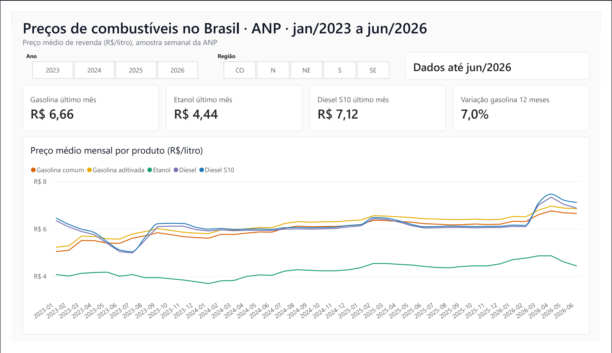
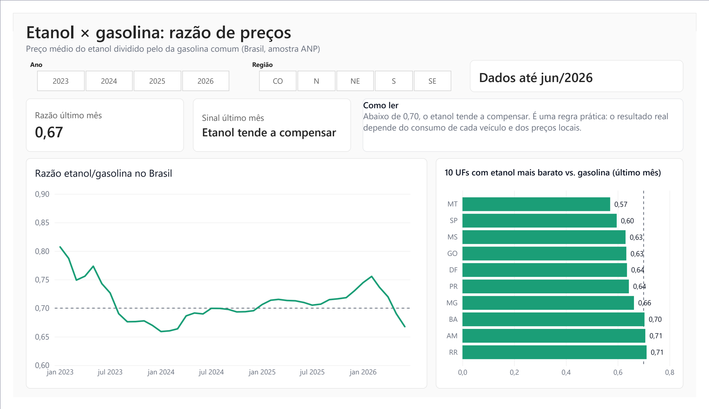
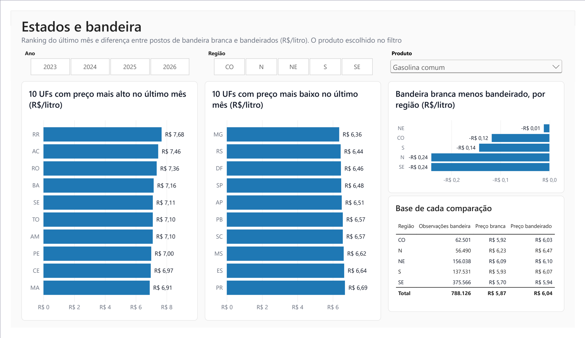

# Preços de combustíveis no Brasil (ANP), 2023 a 2026

Projeto de análise de dados com dados abertos da ANP: do download dos arquivos brutos até um painel em Power BI, passando por limpeza em Python e modelagem e consultas em PostgreSQL.

**Base:** Série Histórica de Preços de Combustíveis da ANP, de 02/01/2023 a 30/06/2026 (2.964.388 observações tratadas, 21.799 postos, 27 UFs, 5 produtos).
**Painel:** [`powerbi/painel_combustiveis.pdf`](powerbi/painel_combustiveis.pdf) (versão em PDF) e [`powerbi/painel_combustiveis.pbix`](powerbi/painel_combustiveis.pbix) (arquivo do Power BI).

## Painel







## Perguntas respondidas

1. O etanol compensa? Em quais estados e em quantos meses?
2. Quais são os estados mais caros e mais baratos?
3. Como o preço evoluiu ao longo do tempo?
4. Postos de bandeira branca são mais baratos que os bandeirados?
5. Quanto o preço varia dentro do mesmo município?

As perguntas e os critérios estão em [`docs/perguntas.md`](docs/perguntas.md). As respostas completas, com números e ressalvas, estão em [`docs/achados.md`](docs/achados.md).

## Principais resultados

- **Jun/2026 (média do Brasil):** gasolina comum R$ 6,66, etanol R$ 4,44 e diesel S10 R$ 7,12. A gasolina subiu 7,0% em 12 meses.
- **Etanol:** a razão etanol/gasolina do Brasil foi de 0,67 em jun/2026. Pela regra prática de 0,70, o etanol compensou em 7 estados (MT, SP, MS, GO, DF, PR e MG), e só de forma consistente no Centro-Oeste, em SP e no PR.
- **Estados:** em jun/2026, RR (R$ 7,68) e AC (R$ 7,46) tinham a gasolina mais cara; MG (R$ 6,36) e RS (R$ 6,44), a mais barata. O ranking muda conforme o período.
- **Bandeira:** a bandeira branca é mais barata no total dos três principais produtos e em todas as regiões, com diferença quase nula no Nordeste. É uma comparação descritiva, que não controla por município.
- **Dentro do município:** nos 20 municípios com maior dispersão, a faixa entre o percentil 10 e o 90 vai de R$ 0,98 a R$ 1,74 por litro na gasolina.

## Como foi feito

| Etapa | Ferramenta | Arquivos |
|---|---|---|
| 1. Download dos arquivos semestrais | Python (Google Colab) | `notebooks/01_baixar_dados.ipynb` |
| 2. Inspeção das colunas e da qualidade | Python (pandas) | `notebooks/02_inspecao.ipynb` |
| 3. Limpeza e padronização | Python (pandas) | `notebooks/03_limpeza.ipynb` |
| 4. Exportação para o banco | Python (pandas) | `notebooks/04_exportar_para_sql.ipynb` |
| 5. Modelo e carga | PostgreSQL | `sql/01_criar_tabelas.sql`, `sql/02_indices.sql` |
| 6. Consultas de análise | PostgreSQL | `sql/03_consultas.sql`, `sql/03b_consultas_extras.sql` |
| 7. Painel | Power BI | `sql/04_views_powerbi.sql`, `powerbi/` |

**Modelo de dados:** `dim_produto`, `dim_posto` (chave: CNPJ) e `fato_preco`, com chaves estrangeiras e restrição de unicidade por posto, produto e data da coleta.

## Decisões sobre a qualidade dos dados

- Preços muito acima da mediana do mesmo produto, UF e mês (mais de 1,5 vez) foram removidos. Preços abaixo de 0,7 ou entre 1,3 e 1,5 vez a mediana foram **mantidos e marcados** como atípicos (`preco_atipico`).
- Um teste de sensibilidade mostrou que incluir ou excluir os 8.249 preços marcados muda o preço médio em menos de R$ 0,01 em todos os produtos.
- O funil completo, da base bruta à base tratada, e cada regra aplicada estão em [`docs/decisoes.md`](docs/decisoes.md).

## Como reproduzir

1. **Dados:** baixe os arquivos semestrais da [Série Histórica de Preços de Combustíveis da ANP](https://www.gov.br/anp/pt-br/centrais-de-conteudo/dados-abertos/serie-historica-de-precos-de-combustiveis). Os notebooks `01` a `03`, no Google Colab com o Drive conectado, baixam, inspecionam e limpam os dados.
2. **Exportação:** o notebook `04` gera os CSVs das tabelas do modelo.
3. **Banco:** crie um banco no PostgreSQL (testado na versão 19, com o pgAdmin 4), rode `sql/01_criar_tabelas.sql`, importe os CSVs (Import/Export Data, na ordem `dim_produto`, `dim_posto`, `fato_preco`) e rode `sql/02_indices.sql`.
4. **Análise:** rode `sql/03_consultas.sql` e `sql/03b_consultas_extras.sql` por bloco.
5. **Painel:** rode `sql/04_views_powerbi.sql` (cria as duas views), exporte os 3 resultados para CSV e carregue no Power BI.

**Atenção ao decimal no Power BI:** os CSVs exportados pelo pgAdmin usam ponto como separador decimal. Em um Power BI em português, converta as colunas numéricas com *Alterar Tipo → Usando a Localidade → Inglês (Estados Unidos)*, senão `7.248` é lido como 7248.

Os arquivos brutos e os CSVs grandes não estão no repositório, por causa do limite de tamanho do GitHub (a pasta `dados_brutos/` está no `.gitignore`).

## Limites

- Os preços vêm de uma pesquisa semanal por amostragem de postos (cerca de 459 localidades), não do universo de postos do país.
- As médias não ponderam por volume vendido.
- Estados com poucos postos pesquisados oscilam mais.
- A regra de 0,70 para o etanol é uma heurística e não considera o consumo de cada veículo.
- Os resultados são descritivos e não indicam relações de causa e efeito.

## Estrutura do repositório

```
.
├── docs/            perguntas, decisões de limpeza e achados
├── notebooks/       etapas 1 a 4 em Python (Colab)
├── powerbi/         painel (.pbix), PDF e imagens
├── sql/             modelo, índices, consultas e views do painel
├── .gitignore
└── README.md
```

## Autora

Patrícia Falchi, em transição de carreira para análise de dados e BI.
[LinkedIn](https://www.linkedin.com/in/patricia-falchi) · [GitHub](https://github.com/PatriciaFalchi)
